# Docker Compose Nextcloud 完整迁移

[返回 README](./README.md) · [平台使用指引](./平台使用指引.md) · [另一套 Nextcloud 教程](./Kubernetes-Nextcloud-迁移教程.md)

本教程使用 `192.168.112.51` 上的 Nextcloud Compose 项目，目标 Namespace 为 `nextcloud-compose-demo`。迁移包含 Nextcloud、MariaDB、Redis、数据库卷和文件卷，采用 Compose Kopia。

真实项目名为 `nextcloud-redis-mariadb`，配置文件为 `/root/awesome-compose/nextcloud-redis-mariadb/compose.yaml`。服务名为 `nc`、`db`、`redis`，named volume 为 `nc_data` 和 `db_data`；示例中的服务显示名以 Inventory 为准。

> **保护凭证**：截图和报告只展示环境变量键名，不展示管理员密码、数据库密码、SSH 密钥或 Harbor Token。

## 开始前：登录并检查迁移环境

本教程面向 v0.5.0。截图来自已完成的实验室迁移，环境名称、地址、端口和任务编号仅作示例；实际填写自己的环境。已登记的环境无需重复添加。

1. 浏览器打开部署脚本输出的平台地址，使用管理员账号登录。新安装默认密码见安装说明；升级保留已有密码，不会重置。登录后从右上角管理员菜单修改初始密码。
2. 进入 **环境 → 源环境**，点击 **添加源环境**，选择 **Docker Compose**。填写 SSH 地址、用户及认证信息。SSH 用户需要能够操作 Docker 并读取 Compose、.env 和引用文件；如校验主机指纹，应通过可信渠道核对，不要盲目信任陌生主机。
3. 保存后点击 **测试连接**，确认已连接；再点击 **能力发现**，核对版本和项目目录、配置路径及 Docker/Compose 能力。
4. 进入 **环境 → SmartX SKS**，导入目标工作负载集群 kubeconfig，测试连接并刷新能力快照。确认集群有足够容量，且节点能访问迁移镜像仓库。
5. 进入 **系统设置 → 对象存储**，确认已有对象存储连接正常、可读写且空间充足。源端与平台必须能访问用于迁移的对象存储；镜像仓库凭证需允许推送。
6. 本教程使用独立目标 Namespace。进入 **迁移策略 → 资源映射**，为目标 SKS 配置下文的 Namespace 规则，再在创建迁移时选择该映射。一般迁移不强制填写映射。


*图 1：登录平台。点击图片可查看原图。*

- **操作**：输入安装时的管理员账号和密码，点击登录。
- **预期结果**：进入概览；登录后立即修改初始密码。
- **失败处理**：认证失败先确认当前密码，升级不会重置已修改密码。


*图 4：源环境列表。点击图片可查看原图。*

- **操作**：进入环境→源环境，找到主机或集群。
- **预期结果**：类型、连接状态与地址符合预期。
- **失败处理**：地址不符时不要继续迁移，先检查保存的凭证。

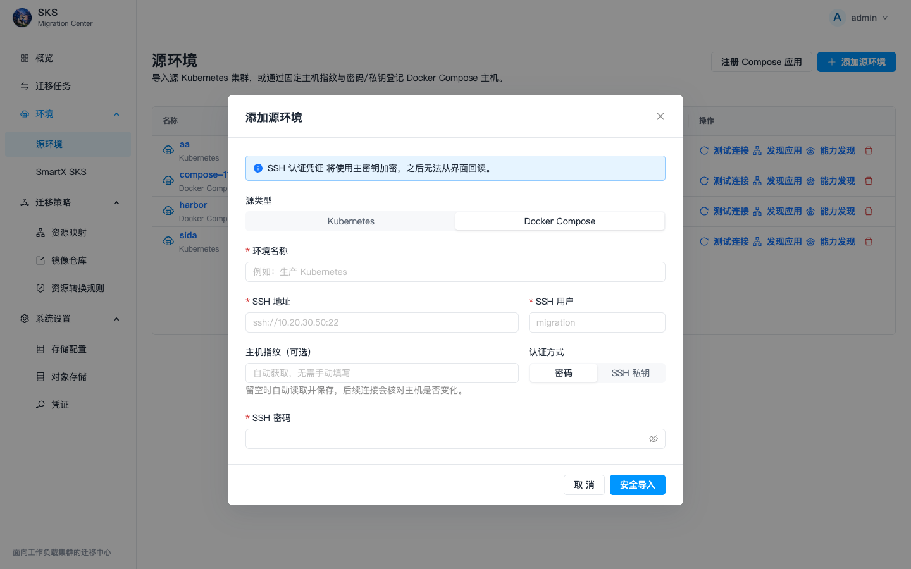

*图 24：添加 Compose 主机。点击图片可查看原图。*

- **操作**：填写 SSH 地址、用户和认证；指纹可选。
- **预期结果**：连接和 Docker/Compose 检查通过。
- **失败处理**：自动获取指纹仍需可信核验；权限不足按路径授权。

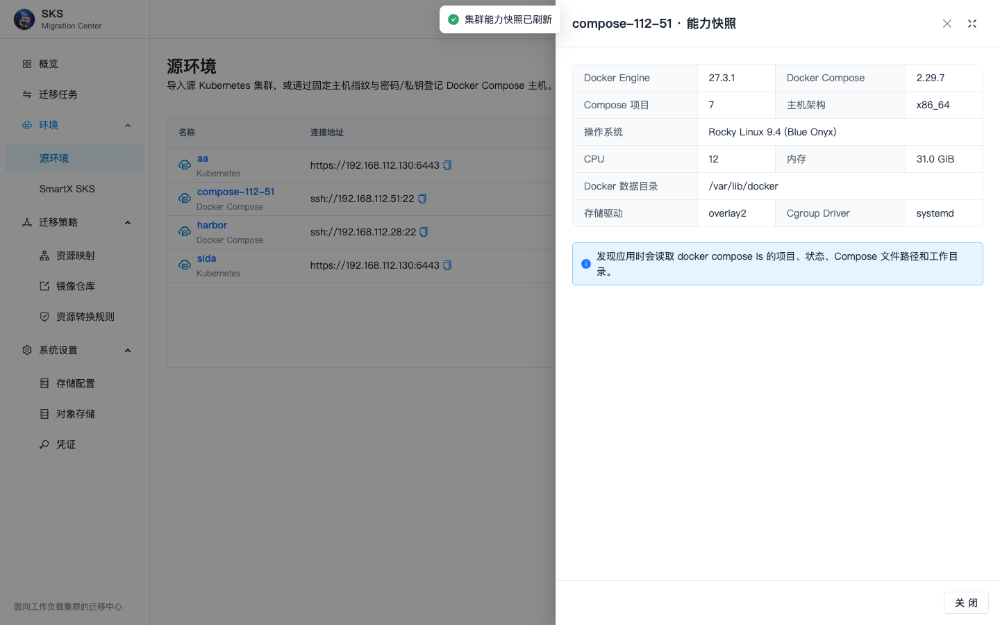

*图 35：Compose 能力发现。点击图片可查看原图。*

- **操作**：在对应主机点击能力发现。
- **预期结果**：Docker/Compose 版本及项目能力可见。
- **失败处理**：发现项目路径来自源主机，不能用本地路径替代。


*图 5：目标 SKS 列表。点击图片可查看原图。*

- **操作**：进入 SmartX SKS，核对目标工作负载集群。
- **预期结果**：目标连接正常，能力快照可读取。
- **失败处理**：不要导入 Cluster API 管控集群；连接失败先查权限。


*图 10：对象存储列表。点击图片可查看原图。*

- **操作**：确认默认 MinIO 或自建 S3 已登记，测试连接。
- **预期结果**：仓库存在，源/目标可达。
- **失败处理**：检查 endpoint、bucket、prefix 及 BSL 实际配置。


*图 6：资源映射列表。点击图片可查看原图。*

- **操作**：查看 SC/NS/NFS 等规则数量，打开配置。
- **预期结果**：找到本教程的 Namespace 映射配置。
- **失败处理**：没有配置时可自动迁移；需要独立 Namespace 才创建规则。

> 安全提示：不要把 SSH 密码、Token、Secret 值、私钥或 kubeconfig 提交到仓库。迁移会停止源业务，先安排维护窗口。教程结束后的源端恢复只适用于实验验证；生产切流后不要同时把源端和目标端接入流量，避免双写。

## 1. 建立数据基线

1. 登录源 Nextcloud。
2. 新建目录 `SKS-Compose-Migration-v0.5.0`。
3. 上传教程文件，例如 `compose-nextcloud-migration.txt`。
4. 下载源文件并记录文件大小与 SHA-256；迁移后下载目标文件，用相同方法复核。Linux 可用 `sha256sum compose-nextcloud-migration.txt`，macOS 可用 `shasum -a 256 compose-nextcloud-migration.txt`。

预期结果：源端可以下载文件，校验值稳定，MariaDB 和 Nextcloud volume 均有实际数据。

## 2. 发现应用

1. 进入 **环境 → 源环境**。
2. 找到 Compose 主机，先点 **测试连接**。
3. 点击 **发现应用**。平台读取 `docker compose ls -a` 和项目 Config Files。
4. 打开 Nextcloud Inventory，确认 Service 为 Nextcloud、MariaDB、Redis，volume 至少包含文件卷和数据库卷。

如果只发现部分应用，检查 SSH 用户是否能读取 Compose 文件、`.env` 和引用目录。不要单独上传脱离项目目录的 compose 文件代替主机发现。

## 3. 创建迁移

1. 进入 **迁移任务 → 创建迁移**。
2. 选择 Compose 源环境和 Nextcloud 应用。
3. 目标选择 SmartX SKS。
4. 展开兼容性得分，处理全部 BLOCKER；逐项确认 WARNING。
5. 通常目标映射可留空，平台按项目名自动创建 Namespace。本教程需要独立命名空间：先在“资源映射”创建 `nextcloud-redis-mariadb` → `nextcloud-compose-demo` 规则，再在向导选择该映射。向导没有独立的 Namespace 输入框。
6. 数据策略选择 **Compose Kopia**。
7. 确认在线预同步、停止源业务、最终备份、验证和人工切流设置。

## 4. 执行与观察

执行时序应依次出现：执行期检查、镜像同步、在线预同步、停止源业务、最终备份、数据传输、资源转换、目标恢复、业务验证和等待人工切流。

在 **数据迁移** 页确认两个 volume 均为完成，且传输量不是 0。拓扑中每个 Compose Service 应映射到目标 Service 与 Deployment，每个 named volume 映射到 PVC。

## 5. 目标验证与切流

1. 通过目标入口登录 Nextcloud。
2. 打开 `SKS-Compose-Migration-v0.5.0` 目录并下载教程文件。
3. 核对文件名、大小和 SHA-256 与源端一致。
4. 检查目标 MariaDB、Redis 和 Nextcloud Pod Ready，PVC Bound。
5. 在外部完成 DNS/VIP/Ingress 切换后，回到平台点击 **确认人工切流**。

## 6. 恢复源端

教程场景从任务右上角操作菜单选择 **恢复源端**。平台会启动迁移前处于运行状态的 Compose 服务，不删除目标资源。恢复后再次访问源端并复核文件。

## 验收清单

本次实迁文件 `compose-nextcloud-migration.txt` 为 76 字节；迁移前源端、目标端及恢复后源端的 SHA-256 均为：

升级后的 v0.5.0 原生复测 Run 为 `2a972bfc-559e-4837-bbda-38e9944b00fd`，迁移成功且源端恢复；两个卷共传输 1,127,906,204 字节。第一次截图任务和复测任务均保留，方便在列表中对照。

```text
a6886a06a915f73e5f91542539812f15d12cbc5bb3d068423942990618e2b4a9
```

目标测试入口为 `http://192.168.118.206:31999`。若 Nextcloud 提示“不受信任域名”，这是应用入口配置，不代表数据丢失：在**目标** `nc` 容器中通过 `occ config:system:set trusted_domains` 添加实际目标主机与端口，再登录验证。生产切流需管理员配置真实 DNS/VIP；本教程只切换测试访问入口，不修改公共 DNS。

- 任务结论为迁移成功，失败/缺失为 0。
- 目标 Namespace 是 `nextcloud-compose-demo`。
- 两个卷都有完成状态和实际传输量。
- 目标与恢复后的源端都能登录。
- 教程文件 SHA-256 三次一致：迁移前源端、目标端、恢复后源端。

## 图解操作

### Compose 数据基线

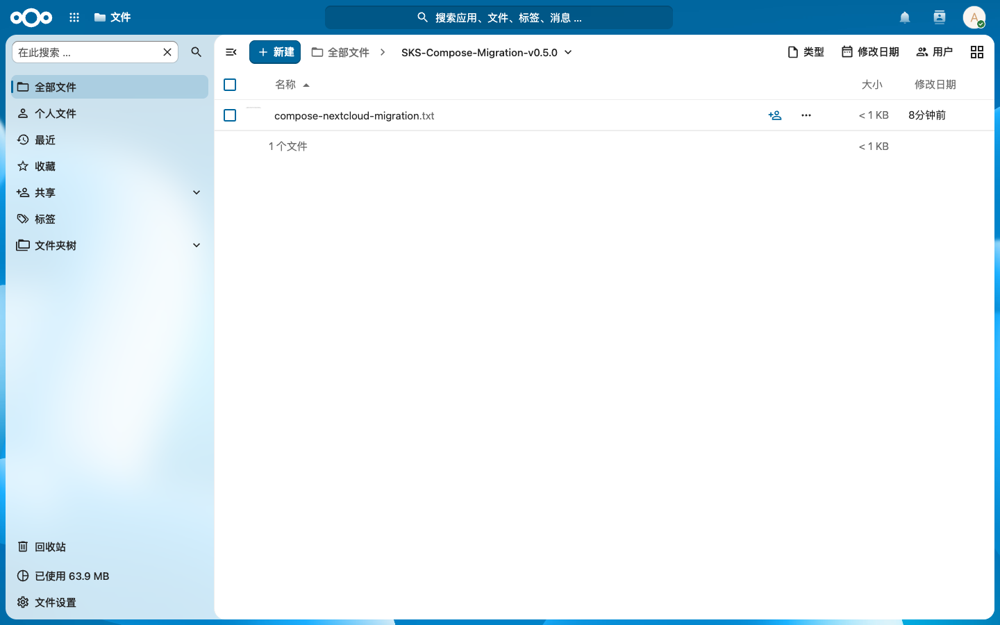

*图 14：Compose 数据基线。点击图片可查看原图。*

- **操作**：在源 Nextcloud 上传 Compose 教程文件。
- **预期结果**：文件位于 SKS-Compose-Migration-v0.5.0。
- **失败处理**：不要与 Kubernetes 文件混用，记录独立校验值。


### 创建任务与等待人工切流（按顺序）

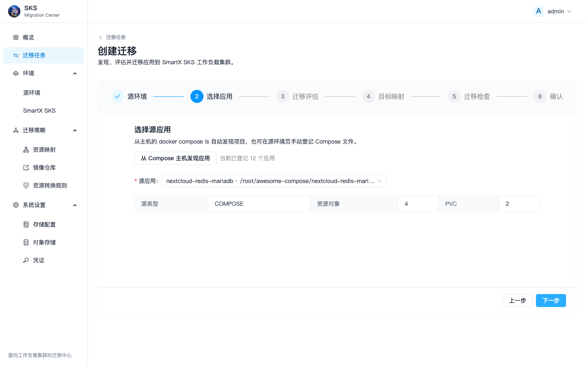

*图 46：向导第 2 步：Compose 应用。点击图片可查看原图。*

- **操作**：选择主机发现的 nextcloud-redis-mariadb，核对三个服务和两个卷后点下一步。
- **预期结果**：选择实际运行项目，Inventory 不混入旧注册应用。
- **失败处理**：找不到项目时回源环境发现应用，检查文件读取权限。


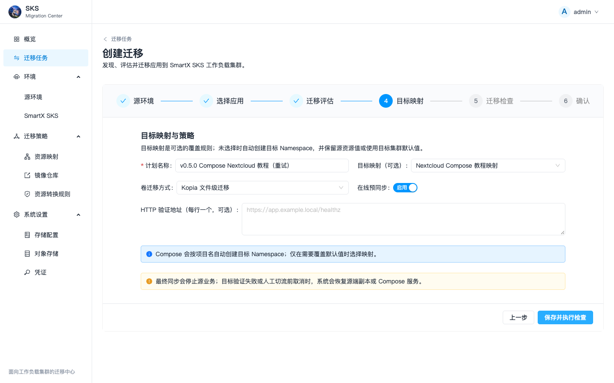

*图 47：向导第 4 步：映射与策略。点击图片可查看原图。*

- **操作**：输入计划名称，选择教程 Namespace 映射，保留 Kopia 和在线预同步。
- **预期结果**：目标为 nextcloud-compose-demo；保存并执行检查进入下一步。
- **失败处理**：映射可不选，但教程独立命名空间需要选正确规则。


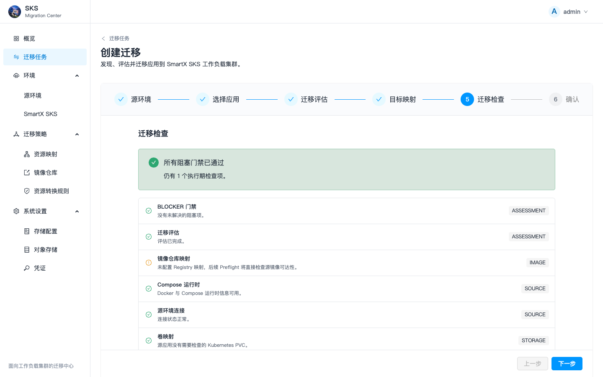

*图 48：向导第 5 步：前置检查。点击图片可查看原图。*

- **操作**：逐条展开前置检查，确认 BLOCKER 为 0。
- **预期结果**：镜像、连接、对象存储及数据迁移组件检查可通过。
- **失败处理**：按失败检查的修复建议处理后重新检查，不绕过 BLOCKER。


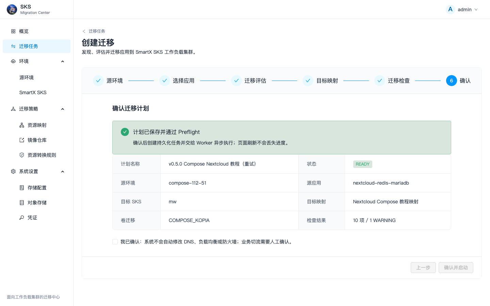

*图 49：向导第 6 步：确认启动。点击图片可查看原图。*

- **操作**：核对源、目标、应用和策略，勾选人工切流声明后确认并启动。
- **预期结果**：创建新的 Run，最终同步会短暂停止源业务。
- **失败处理**：若摘要不符回上一步；截图演示确认页，不自动重复启动。


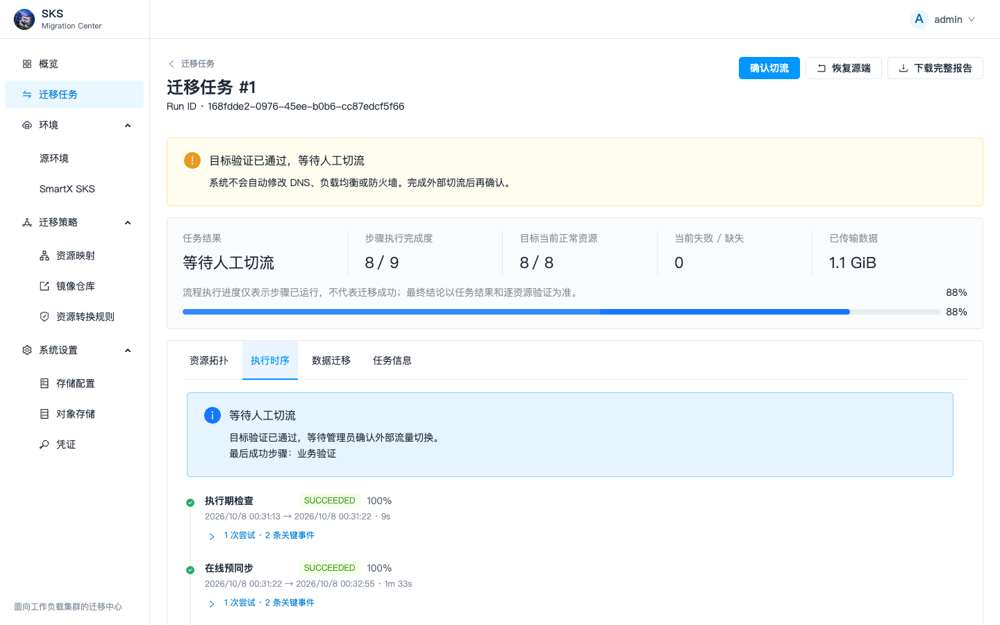

*图 29：Compose 等待人工切流。点击图片可查看原图。*

- **操作**：阅读目标验证结果，再进行业务测试。
- **预期结果**：三个工作负载及两个卷恢复完成。
- **失败处理**：等待切流不是卡住，无须重复启动任务。


### Compose 卷传输

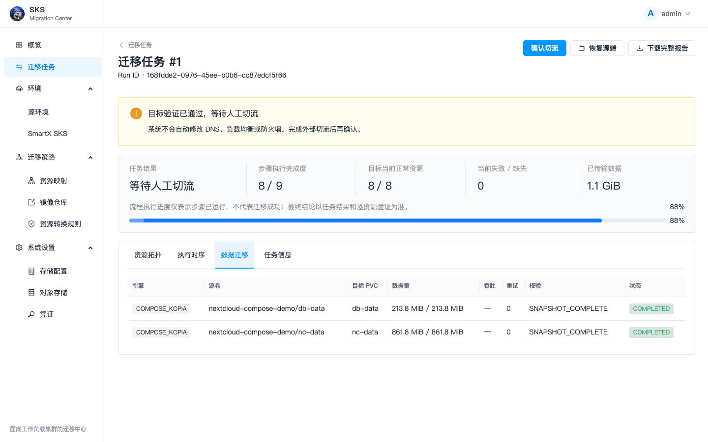

*图 30：Compose 卷传输。点击图片可查看原图。*

- **操作**：核对 db-data 与 nc-data 的 Kopia 记录。
- **预期结果**：两个卷 COMPLETED，传输不是 0。
- **失败处理**：看到数据目录仍需下载文件验证内容。


### 确认 Compose 人工切流

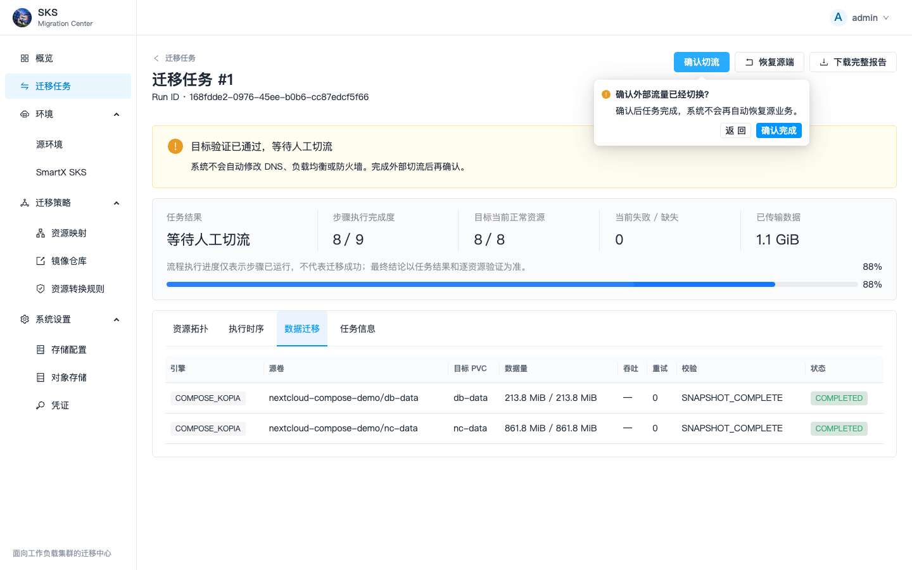

*图 31：确认 Compose 人工切流。点击图片可查看原图。*

- **操作**：目标文件验证通过后确认割接。
- **预期结果**：任务完成，保留目标和备份证据。
- **失败处理**：不能将该确认当作自动 DNS 操作。


### 目标 Compose 文件验证


*图 32：目标 Compose 文件验证。点击图片可查看原图。*

- **操作**：登录目标并下载 Compose 教程文件。
- **预期结果**：76 字节，与源端 SHA-256 一致。
- **失败处理**：Nextcloud trusted_domains 属于应用配置，须添加目标入口。


### 恢复 Compose 源端

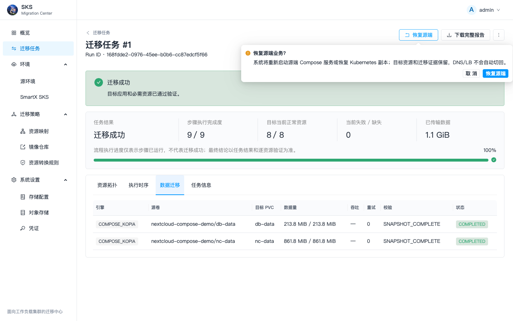

*图 33：恢复 Compose 源端。点击图片可查看原图。*

- **操作**：点击恢复源端，确认重新启动原服务。
- **预期结果**：源地址可以再次登录，原文件保持一致。
- **失败处理**：数据库与文件卷均需保留；不要 docker compose down -v。


### 应用视图

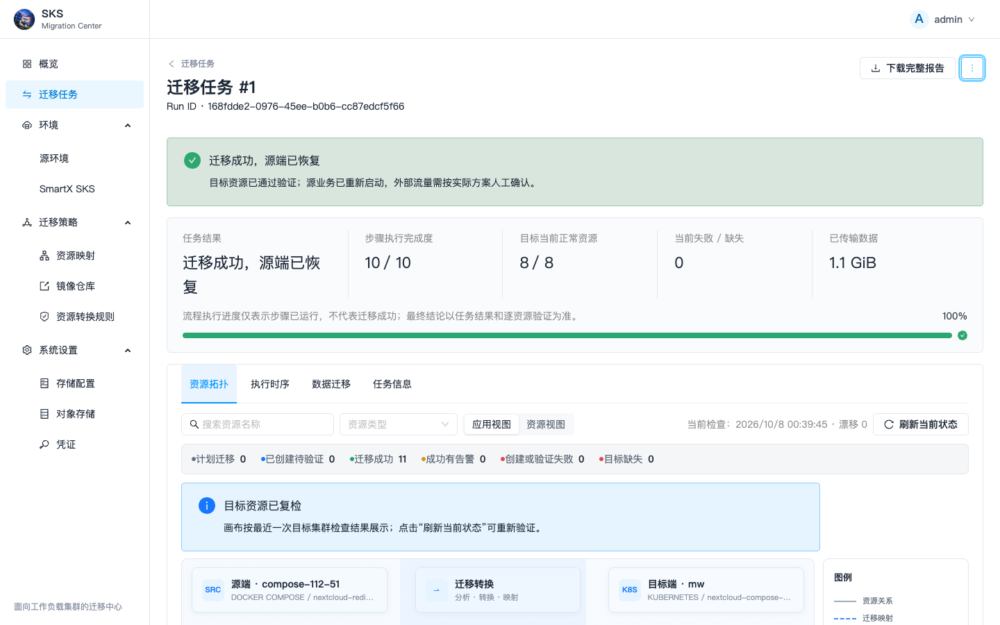

*图 38：应用视图。点击图片可查看原图。*

- **操作**：按业务链路查看 Compose 到 Kubernetes 的转换。
- **预期结果**：Service/Deployment/PVC 对应关系清楚。
- **失败处理**：无独立目标的 Compose 网络应说明转换语义而非失败。


## 任务操作与结束检查


*图 34：更多任务操作。点击图片可查看原图。*

- **操作**：点击右上 …，选择编辑、重执行或清理。
- **预期结果**：每项操作有独立确认和边界。
- **失败处理**：删除任务不删除业务；清理备份前确认回滚窗口。

- **恢复源端**：只恢复停止的源服务或副本，不删除目标；恢复完成后检查源应用可访问。
- **编辑任务 / 重新执行**：先根据执行时序中的具体错误修正配置，再创建新的执行记录；不要把旧记录覆盖成新记录。
- **下载完整报告**：保存资源验证、卷传输与切流证据，便于交接和排查。
- **删除任务 / 清理备份**：确认不再需要追溯和恢复后再操作，先核对确认框的删除范围；不要把删除记录当成回滚业务。
- **判断成功**：目标资源验证通过、文件校验一致、目标业务可登录；不能仅以进度 100% 或 Pod Running 判断数据迁移成功。
