# Kubernetes Nextcloud 完整迁移

[返回 README](./README.md) · [平台使用指引](./平台使用指引.md) · [另一套 Nextcloud 教程](./Compose-Nextcloud-迁移教程.md)

源 Namespace 为 `nextcloud-k8s-source`，包含 Nextcloud、MariaDB、Redis、Service、Secret、ConfigMap，以及 Nextcloud 和 MariaDB 两个使用 `smtx-elf-csi-driver` 的 PVC。目标 Namespace 为 `nextcloud-k8s-demo`，数据策略为 Velero FSB。

本实验室部分截图中的源环境显示为 `aa`，它是同一个 sida 工作负载集群的既有登记别名，并非另一个集群。实际操作请以自己导入的 sida 环境及其 API 地址为准，不要照抄截图中的名称或 UUID。

## 开始前：登录并检查迁移环境

本教程面向 v0.5.0。截图来自已完成的实验室迁移，环境名称、地址、端口和任务编号仅作示例；实际填写自己的环境。已登记的环境无需重复添加。

1. 浏览器打开部署脚本输出的平台地址，使用管理员账号登录。新安装默认密码见安装说明；升级保留已有密码，不会重置。登录后从右上角管理员菜单修改初始密码。
2. 进入 **环境 → 源环境**，点击 **添加源环境**，选择 **Kubernetes**。导入 sida 工作负载集群的完整 kubeconfig 内容，而不是在输入框填写文件路径；不要导入 Cluster API 管控集群。
3. 保存后点击 **测试连接**，确认已连接；再点击 **能力发现**，核对版本和存储、网络及迁移组件能力。
4. 进入 **环境 → SmartX SKS**，导入目标工作负载集群 kubeconfig，测试连接并刷新能力快照。确认集群有足够容量，且节点能访问迁移镜像仓库。
5. 进入 **系统设置 → 对象存储**，确认已有对象存储连接正常、可读写且空间充足。源端和目标端都要准备 Velero、node-agent 与同一迁移对象存储；发现组件缺失时，先在环境操作中修复迁移组件，再重新检查。
6. 本教程使用独立目标 Namespace。进入 **迁移策略 → 资源映射**，为目标 SKS 配置下文的 Namespace 规则，再在创建迁移时选择该映射。一般迁移不强制填写映射。

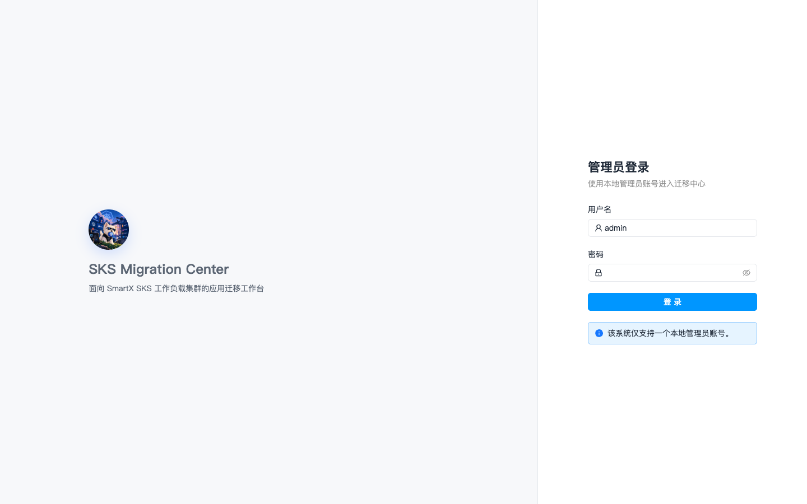

*图 1：登录平台。点击图片可查看原图。*

- **操作**：输入安装时的管理员账号和密码，点击登录。
- **预期结果**：进入概览；登录后立即修改初始密码。
- **失败处理**：认证失败先确认当前密码，升级不会重置已修改密码。

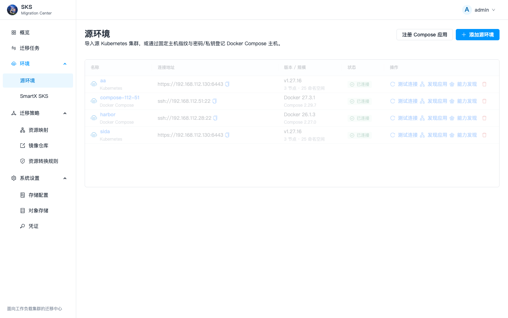

*图 4：源环境列表。点击图片可查看原图。*

- **操作**：进入环境→源环境，找到主机或集群。
- **预期结果**：类型、连接状态与地址符合预期。
- **失败处理**：地址不符时不要继续迁移，先检查保存的凭证。

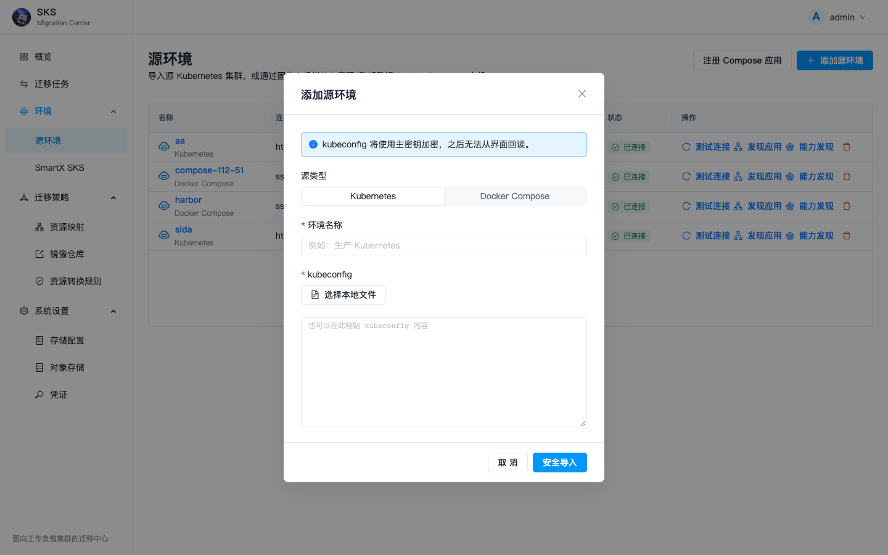

*图 23：添加 Kubernetes 源环境。点击图片可查看原图。*

- **操作**：填写环境名并上传完整 kubeconfig。
- **预期结果**：保存后测试连接通过。
- **失败处理**：不能把文件路径文字当作 kubeconfig 内容。

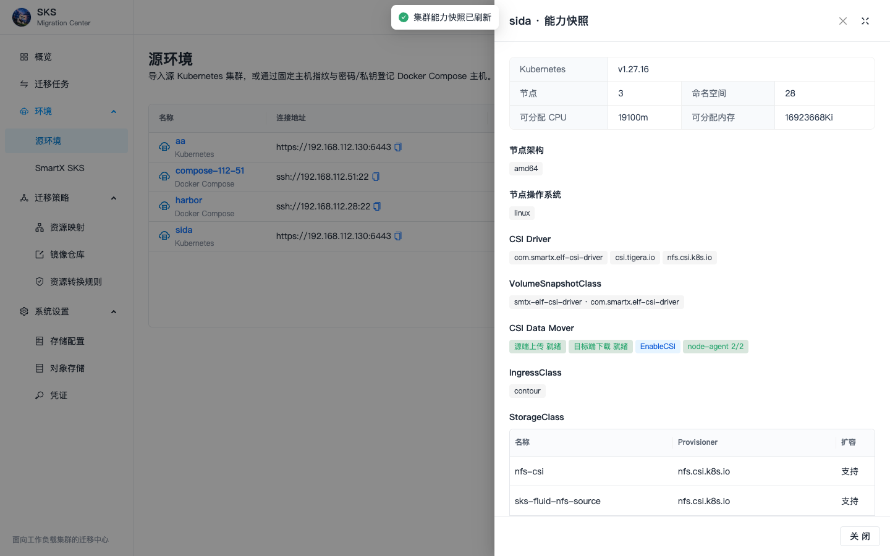

*图 36：Kubernetes 能力发现。点击图片可查看原图。*

- **操作**：在集群点击能力发现，核对 CSI/StorageClass。
- **预期结果**：目标支持所选迁移策略。
- **失败处理**：快照能力不足时使用 FSB，不盲选 CSI Data Mover。

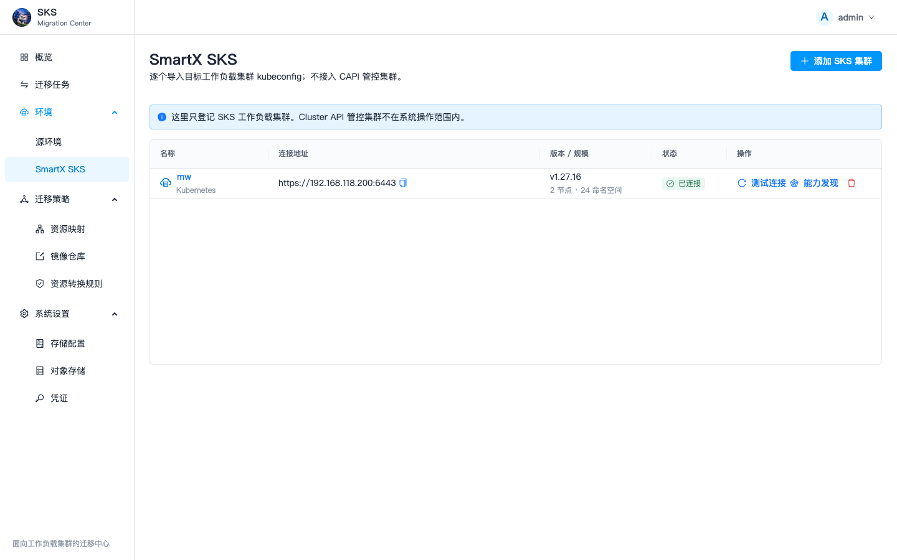

*图 5：目标 SKS 列表。点击图片可查看原图。*

- **操作**：进入 SmartX SKS，核对目标工作负载集群。
- **预期结果**：目标连接正常，能力快照可读取。
- **失败处理**：不要导入 Cluster API 管控集群；连接失败先查权限。

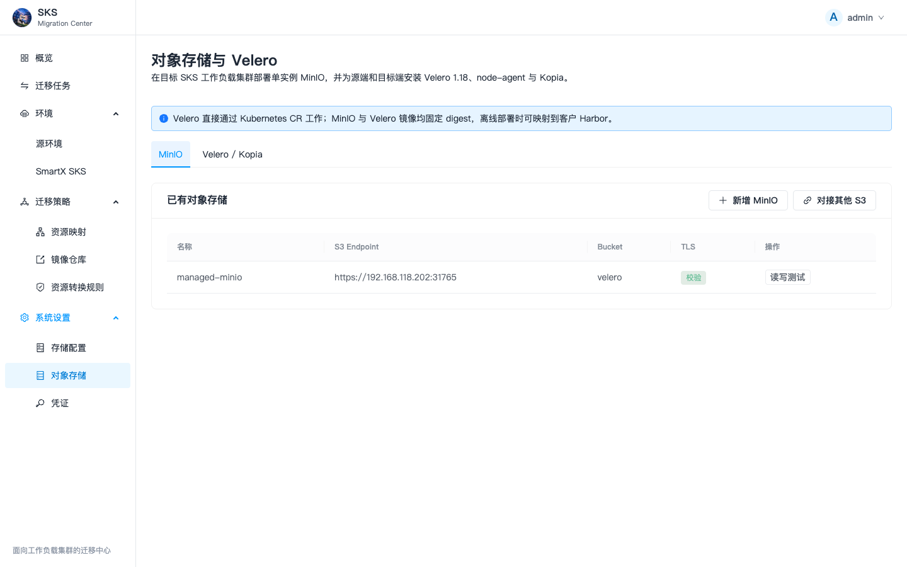

*图 10：对象存储列表。点击图片可查看原图。*

- **操作**：确认默认 MinIO 或自建 S3 已登记，测试连接。
- **预期结果**：仓库存在，源/目标可达。
- **失败处理**：检查 endpoint、bucket、prefix 及 BSL 实际配置。

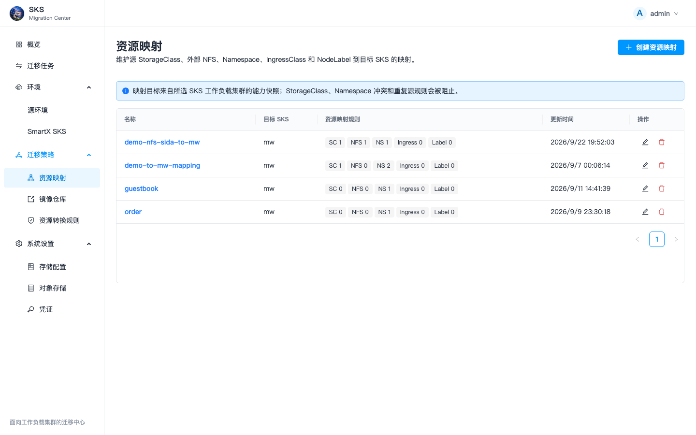

*图 6：资源映射列表。点击图片可查看原图。*

- **操作**：查看 SC/NS/NFS 等规则数量，打开配置。
- **预期结果**：找到本教程的 Namespace 映射配置。
- **失败处理**：没有配置时可自动迁移；需要独立 Namespace 才创建规则。

> 安全提示：不要把 SSH 密码、Token、Secret 值、私钥或 kubeconfig 提交到仓库。迁移会停止源业务，先安排维护窗口。教程结束后的源端恢复只适用于实验验证；生产切流后不要同时把源端和目标端接入流量，避免双写。

## 1. 准备源应用和数据

仓库提供 [Nextcloud Kubernetes 示例清单（下载后保存到本地）](./examples/nextcloud-k8s-source.yaml)，保存到 `examples/nextcloud-k8s-source.yaml`。先创建命名空间，在本地安全文件中准备 `db-password`、`db-root-password`、`admin-password`（文件名即键名），再创建 Secret，最后应用清单；不要将密码写入 Git：

```bash
kubectl --kubeconfig /secure/source-sida.yaml create ns nextcloud-k8s-source
kubectl --kubeconfig /secure/source-sida.yaml -n nextcloud-k8s-source create secret generic nextcloud-credentials \
  --from-file=db-password=/secure/nextcloud/db-password \
  --from-file=db-root-password=/secure/nextcloud/db-root-password \
  --from-file=admin-password=/secure/nextcloud/admin-password
kubectl --kubeconfig /secure/source-sida.yaml apply -f examples/nextcloud-k8s-source.yaml
```

示例访问端口 `31555`；安装前确认端口未被占用。账号为 `tutorial-admin`。示例固定 Nextcloud `35.0.1-apache`，避免同一可变标签在两端缓存成不同版本。

1. 等待 Nextcloud、MariaDB、Redis 全部 Ready，两个 PVC 为 Bound。
2. 登录源 Nextcloud，新建 `SKS-Kubernetes-Migration-v0.5.0`。
3. 上传与 Compose 教程不同的文件，例如 `k8s-nextcloud-migration.txt`。
4. 下载源文件并记录大小和 SHA-256。Linux 可用 `sha256sum k8s-nextcloud-migration.txt`，macOS 可用 `shasum -a 256 k8s-nextcloud-migration.txt`；迁移后下载目标文件再次执行。

## 2. 演示两种选择方式

### 自动发现应用

在 **源环境 → sida → 发现应用** 中扫描 Namespace，选择平台按资源依赖生成的 Nextcloud 应用。适合迁移完整业务。

### 按 Namespace 手选资源

在创建迁移第二步切换为 **按 Namespace 手选资源**，选择 `nextcloud-k8s-source`，点击 **读取资源**。勾选 Nextcloud、MariaDB、Redis 的 Deployment、Service、PVC、ConfigMap、Secret 和 ServiceAccount，保存为迁移应用。

预期结果：选择工作负载后，相关 Service、PVC、配置和密钥会显示关联信息；平台不会要求迁移 Namespace 中无关的系统资源。

## 3. 评估与映射

1. 目标选择 SmartX SKS。
2. 展开兼容性得分，BLOCKER 必须为 0。
3. Namespace 规则设为 `nextcloud-k8s-source` → `nextcloud-k8s-demo`。
4. StorageClass 可保留 `smtx-elf-csi-driver`；只有名称不同时才配置映射。
5. 数据策略选择 **Velero 文件系统备份（FSB）**。

## 4. 迁移执行

执行期检查会验证 Velero、node-agent、BSL 和 BackupRepository。最终备份完成后，目标端恢复资源和两个 PVC，再启动工作负载。

如果页面长时间等待，进入执行时序查看最近心跳与当前等待原因，并在目标环境使用 **修复迁移组件**。修复后创建新 Run，不要修改历史事件。

## 5. 验证、切流与恢复

1. 确认目标两个 PVC Bound，Nextcloud、MariaDB、Redis Ready。
2. 登录目标 Nextcloud，下载教程文件并核对 SHA-256。
3. 确认外部入口切换后点击 **确认人工切流**。
4. 选择 **恢复源端**，平台按迁移前快照恢复源端副本数。
5. 登录恢复后的源 Nextcloud，再次复核文件。

## 验收清单

本次实迁文件 `k8s-nextcloud-migration.txt` 为 79 字节；迁移前源端、目标端及恢复后源端的 SHA-256 均为：

升级后的 v0.5.0 原生复测 Run 为 `60c222e4-a43e-4cbd-b763-d9efaddbabd4`，迁移成功且源端恢复；两个 PVC 共传输 1,083,926,041 字节。本次复测使用已固定版本的源镜像，无需再次修补目标镜像。

```text
99fcb9758506e2b9500abf47b0096230e81f527f176e017f3122b50225ce527d
```

示例中曾遇到目标缓存旧 Nextcloud 镜像而退出：先查看 Pod 日志确认版本，统一目标镜像版本后重新验证。不要把“Pod Running”或传输完成当作应用验证通过。

- 目标 Namespace 是 `nextcloud-k8s-demo`。
- 目标资源验证通过，两个 PVC 数据迁移完成。
- 目标文件 SHA-256 与源端一致。
- 人工切流和恢复源端均有成功事件。
- 源端恢复后副本数与迁移前一致。

## 图解操作

### Kubernetes 数据基线

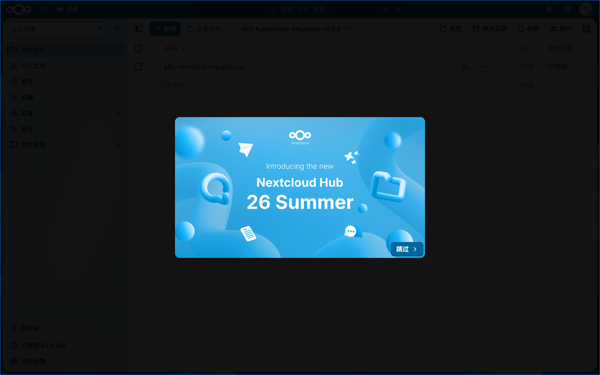

*图 13：Kubernetes 数据基线。点击图片可查看原图。*

- **操作**：在源 Nextcloud 上传独立的教程文件。
- **预期结果**：文件位于 SKS-Kubernetes-Migration-v0.5.0。
- **失败处理**：上传失败先确认源业务 Ready、容量和账号权限。


### 向导第 1 步：源环境

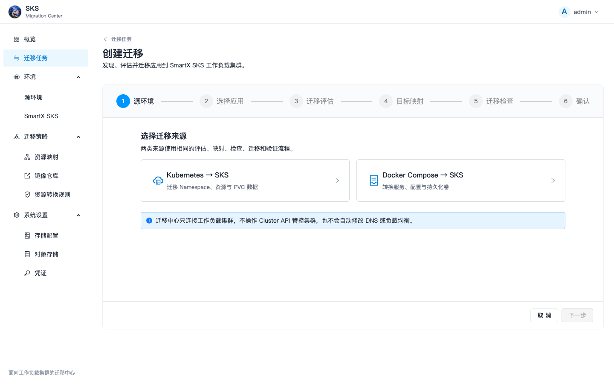

*图 12：向导第 1 步：源环境。点击图片可查看原图。*

- **操作**：选择 Kubernetes 或 Compose，再选择已连接环境。
- **预期结果**：下一步启用，显示与来源匹配的应用。
- **失败处理**：没有环境时返回源环境导入并测试连接。


### 自动发现 Kubernetes 应用

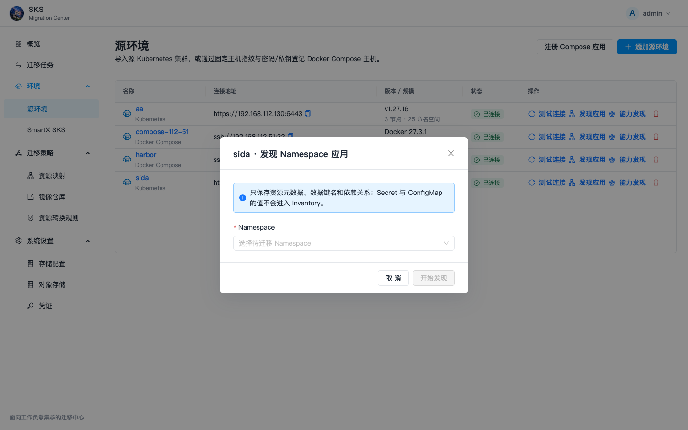

*图 15：自动发现 Kubernetes 应用。点击图片可查看原图。*

- **操作**：在源环境点击发现应用，扫描 Namespace。
- **预期结果**：发现 nextcloud-k8s-source 的业务清单。
- **失败处理**：检查 kubeconfig 对 Namespace 与资源的 list 权限。


### 核对已发现应用

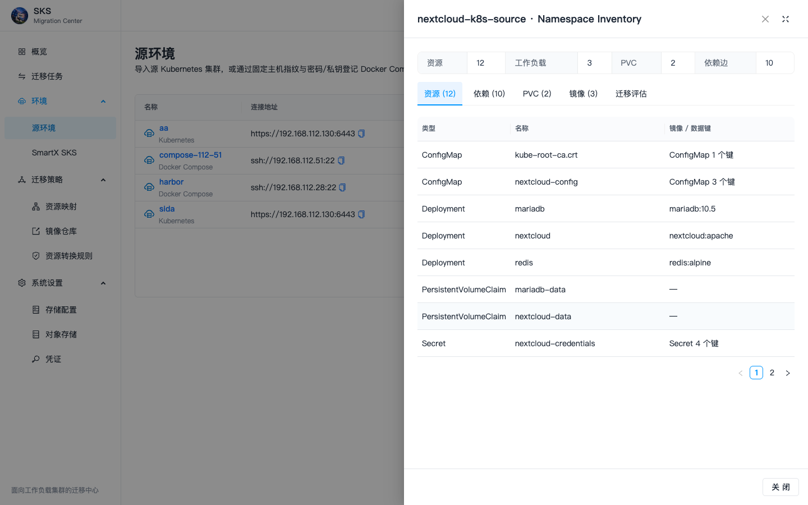

*图 16：核对已发现应用。点击图片可查看原图。*

- **操作**：确认应用名及 Namespace 后再继续。
- **预期结果**：Nextcloud、MariaDB、Redis 和 PVC 在清单中。
- **失败处理**：发现按钮可能默认选第一条，必须核对实际选择。


### 手选 Namespace 资源

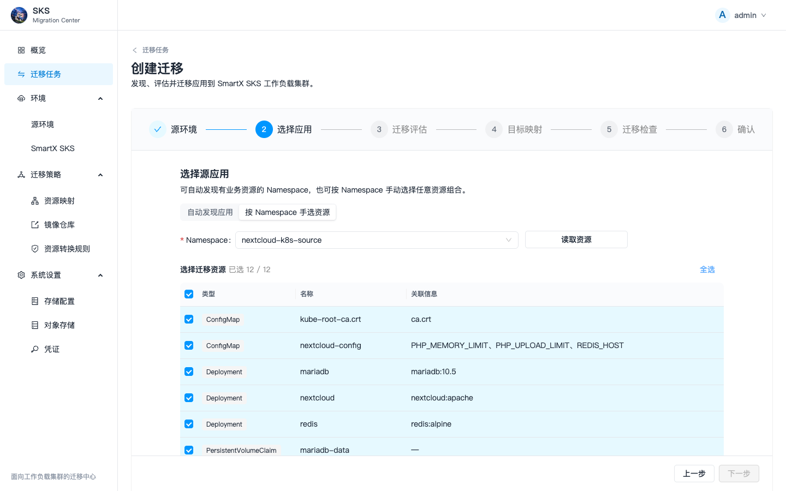

*图 17：手选 Namespace 资源。点击图片可查看原图。*

- **操作**：读取 nextcloud-k8s-source，勾选完整业务资源并保存。
- **预期结果**：保存为命名明确的迁移应用；依赖未遗漏。
- **失败处理**：缺少配置/Secret/PVC 时重新读取，不绕过验证。


### 向导第 3 步：评估

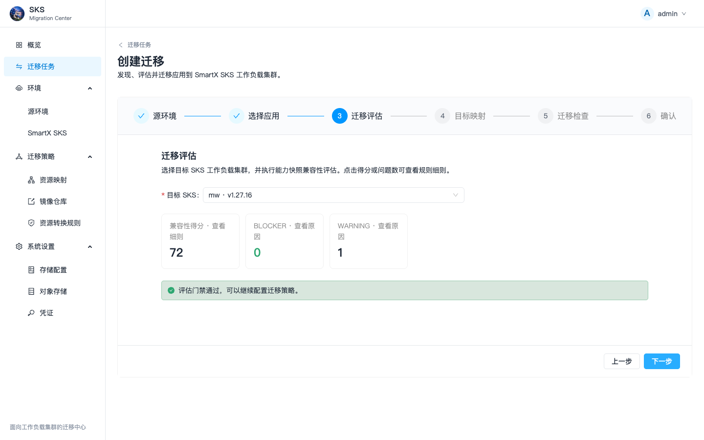

*图 18：向导第 3 步：评估。点击图片可查看原图。*

- **操作**：选目标，点击执行评估，再点击评分卡。
- **预期结果**：BLOCKER 为 0 后可下一步。
- **失败处理**：分数不是成功率；逐项处理阻塞问题。


### 查看评分细则

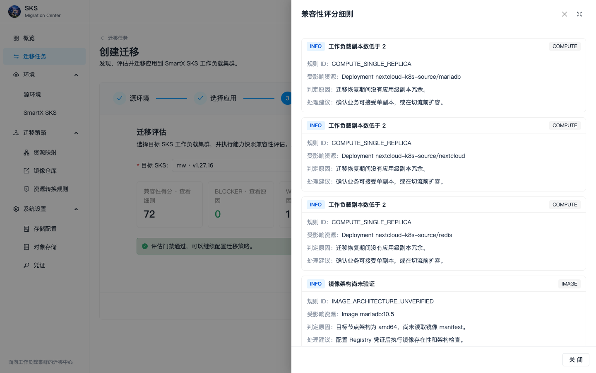

*图 19：查看评分细则。点击图片可查看原图。*

- **操作**：展开 ALL/BLOCKER/WARNING，阅读规则和建议。
- **预期结果**：可看到受影响资源与具体判定。
- **失败处理**：告警不能一概忽略，尤其镜像和存储规则。


### 观察执行时序

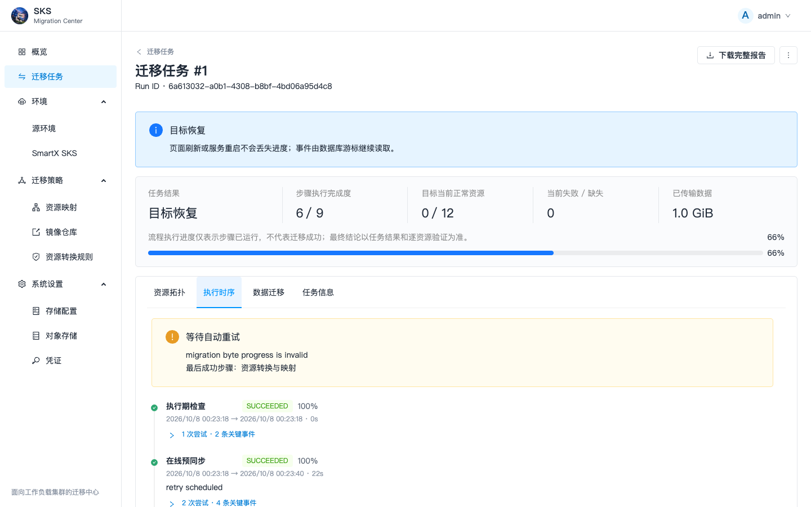

*图 20：观察执行时序。点击图片可查看原图。*

- **操作**：展开当前 Step 的尝试与关键事件。
- **预期结果**：有心跳、阶段结果及等待原因。
- **失败处理**：心跳停止时查 Worker；有心跳但等待时查 Velero。


### Kubernetes 卷传输

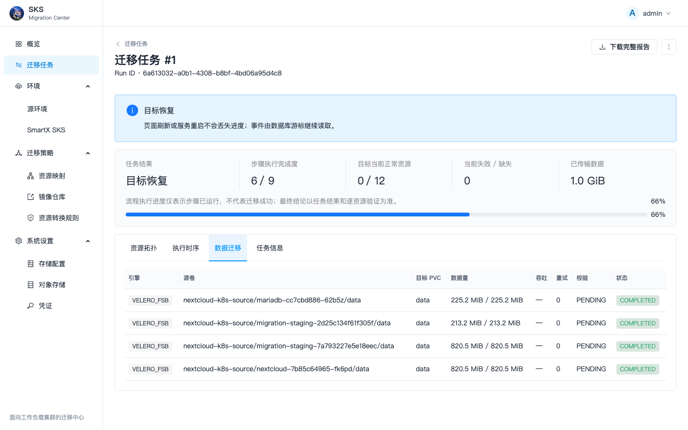

*图 21：Kubernetes 卷传输。点击图片可查看原图。*

- **操作**：核对两个 PVC 的 FSB 备份/恢复记录。
- **预期结果**：最终传输完成且有实际字节数。
- **失败处理**：预同步和最终备份可能分别列行，不代表多出业务 PVC。


### 核对任务信息

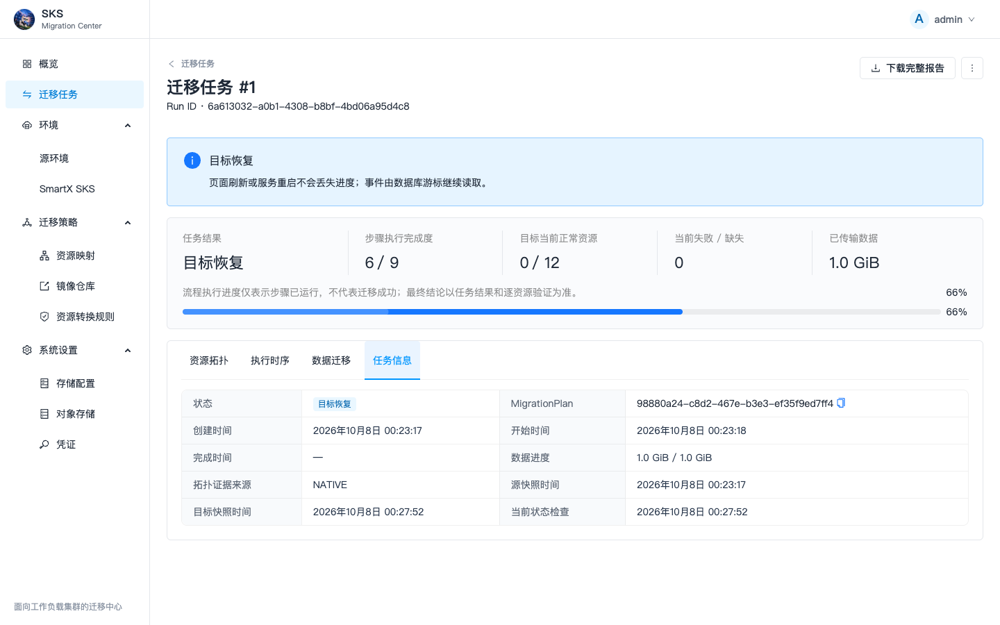

*图 22：核对任务信息。点击图片可查看原图。*

- **操作**：查看计划、环境、策略及 Namespace 映射。
- **预期结果**：目标是 nextcloud-k8s-demo，策略为 FS_BACKUP。
- **失败处理**：发现填错时终止割接并恢复源端，再编辑新任务。


### 确认 Kubernetes 人工切流

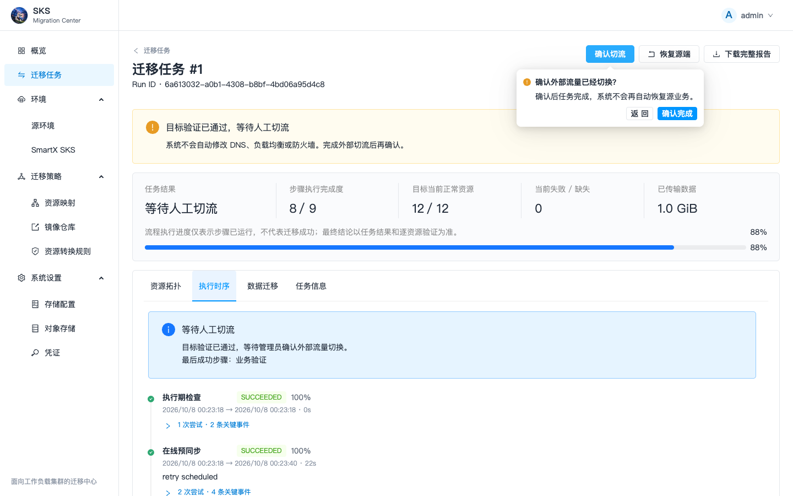

*图 25：确认 Kubernetes 人工切流。点击图片可查看原图。*

- **操作**：验证目标业务后确认测试访问已转到目标入口。
- **预期结果**：Run 完成，源端不会自动恢复。
- **失败处理**：没有完成外部入口切换不要确认；平台不会改 DNS。


### 恢复 Kubernetes 源端

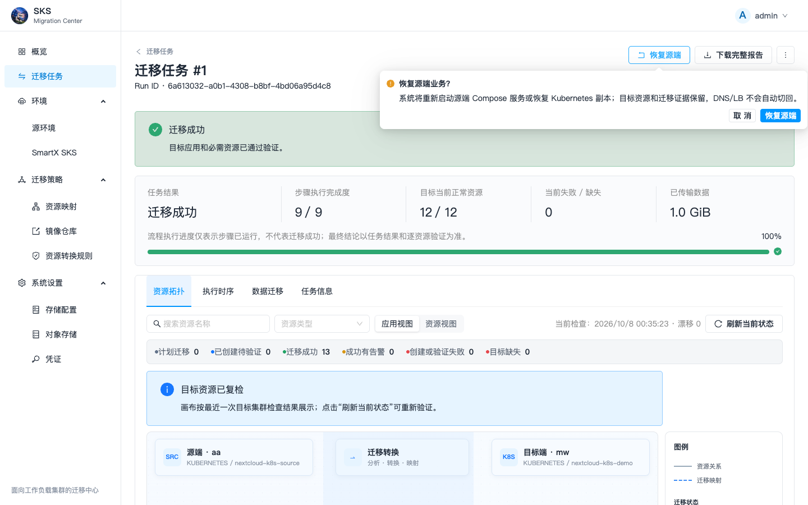

*图 26：恢复 Kubernetes 源端。点击图片可查看原图。*

- **操作**：演示完成后点击恢复源端并确认。
- **预期结果**：原三个 Deployment 副本数恢复。
- **失败处理**：恢复不自动切回 DNS，也不删除目标资源。


### 目标 Kubernetes 文件验证

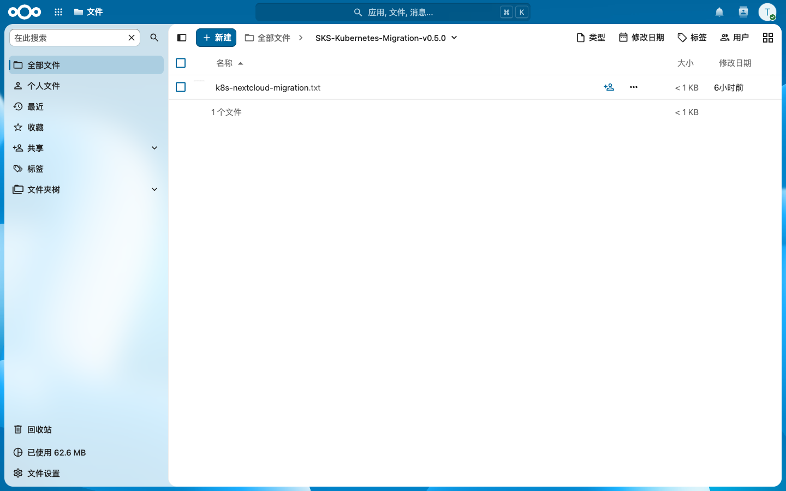

*图 27：目标 Kubernetes 文件验证。点击图片可查看原图。*

- **操作**：登录目标并打开教程目录，下载文件计算 SHA-256。
- **预期结果**：79 字节，校验值与源端一致。
- **失败处理**：若提示不可信域名，在目标 Nextcloud 添加新入口。


### Kubernetes 完成拓扑

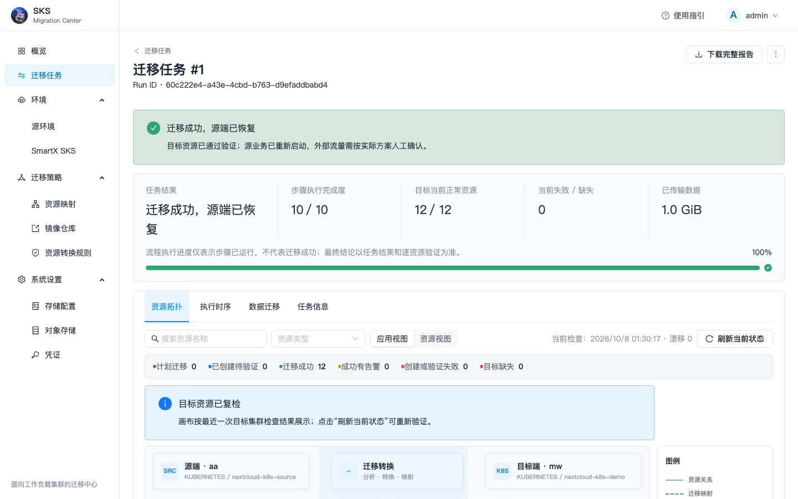

*图 28：Kubernetes 完成拓扑。点击图片可查看原图。*

- **操作**：切到资源拓扑，刷新当前状态。
- **预期结果**：源/映射/目标关系与验证结论可见。
- **失败处理**：映射漂移要对照执行时快照和当前实际镜像。


## 任务操作与结束检查

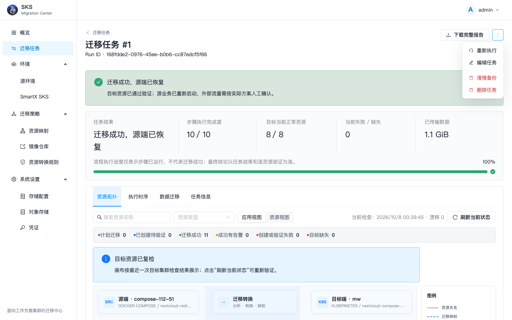

*图 34：更多任务操作。点击图片可查看原图。*

- **操作**：点击右上 …，选择编辑、重执行或清理。
- **预期结果**：每项操作有独立确认和边界。
- **失败处理**：删除任务不删除业务；清理备份前确认回滚窗口。

- **恢复源端**：只恢复停止的源服务或副本，不删除目标；恢复完成后检查源应用可访问。
- **编辑任务 / 重新执行**：先根据执行时序中的具体错误修正配置，再创建新的执行记录；不要把旧记录覆盖成新记录。
- **下载完整报告**：保存资源验证、卷传输与切流证据，便于交接和排查。
- **删除任务 / 清理备份**：确认不再需要追溯和恢复后再操作，先核对确认框的删除范围；不要把删除记录当成回滚业务。
- **判断成功**：目标资源验证通过、文件校验一致、目标业务可登录；不能仅以进度 100% 或 Pod Running 判断数据迁移成功。
